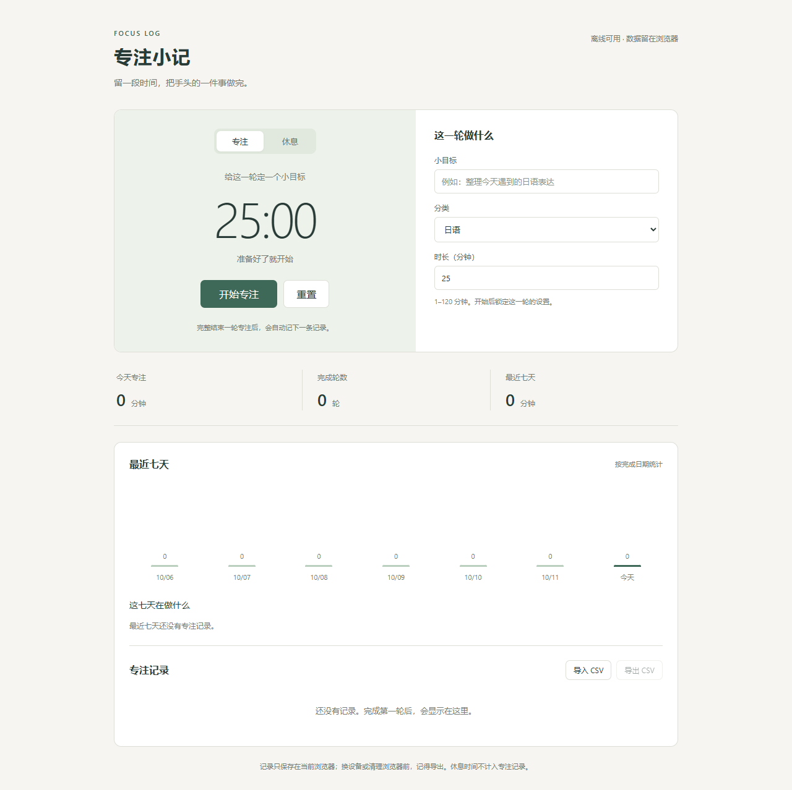

# Focus Log · 专注小记

一个简单的专注计时器。给日语、雅思、电路学习或练琴定一个小目标，完成后留下记录，再看看这一周的时间花在了哪里。

A small focus timer for language study, circuit work, coding, or piano practice. Set a task, finish a session, and keep a record of the time spent.



## 使用 / Use

下载仓库后，用浏览器打开 `index.html` 就能使用，不需要安装依赖。填写目标、分类和时长，点击“开始专注”。完整结束一轮后自动保存；重置未完成的一轮不会增加记录。休息模式默认 5 分钟，不计入专注统计。

Download the repository and open `index.html` in a browser. No dependencies are needed. Enter a task, choose a category and duration, then start. A completed focus session is saved automatically. Resetting an unfinished session adds no record. Break mode defaults to five minutes and does not count toward focus totals.

也可以从仓库目录启动本地服务，再打开 `http://localhost:8000`：

You can also serve the folder locally and visit `http://localhost:8000`:

```sh
python -m http.server 8000
```

## 当前功能 / Current features

- 1–120 分钟计时，暂停、继续和重置。 / A 1–120 minute timer with pause, resume, and reset.
- 刷新或重新打开页面后恢复计时，暂停状态也会保留。 / Restore an active or paused timer after refreshing or reopening the page.
- 记录目标、分类、开始时间、完成时间和专注分钟数。 / Task, category, start time, finish time, and focus minutes.
- 今日汇总与最近七天的简单柱状图。 / Today's totals and a simple chart for the last seven days.
- 最近七天按分类汇总分钟数和完成轮数。 / Minutes and completed sessions by category for the last seven days.
- 导出 CSV，也可以导入备份并合并记录，重复记录会跳过。 / Export CSV backups and import them to merge records, skipping duplicates.

“这七天在做什么”与柱状图都包含今天及前六个本地日期，按完成时间归类。分类按分钟数从多到少排列，横条表示该分类占七天总时长的比例；导入文件里的其他分类也会显示。跨午夜的一轮全部计入完成当天。

The category summary and daily chart both cover today and the previous six local dates, using completion time. Categories are sorted by minutes, and each bar shows its share of the seven-day total. Categories from imported backups are included. A session crossing midnight counts entirely on its completion date.

下图使用合成记录展示分类汇总，并非实际学习数据。 / The example below uses synthetic records, not actual study data.


## 备份与恢复 / Back up and restore

点击“导出 CSV”保存备份。在另一个浏览器或设备打开页面后，点击“导入 CSV”选择该文件。导入会保留已有记录，相同 ID 或相同内容的记录会跳过；正在进行的计时不会重置。文件有错误时，整份备份不会导入，页面会说明原因。

Click “导出 CSV” to save a backup. Open the page in another browser or device and use “导入 CSV” to select the file. Import keeps existing records and skips matching IDs or identical content; it does not reset an active timer. If the file contains an error, the entire import is rejected with a message.

CSV 可用 Excel 或 WPS 查看。列为 `task`、`category`、`started_at`、`finished_at`、`duration_minutes`、`id`、`escaped_fields`。保留原表头和最后两列，才能准确恢复文字与记录 ID。时间以 UTC 的 ISO 格式导出，页面按设备本地时间显示。

You can view the CSV in Excel or WPS. Its columns are `task`, `category`, `started_at`, `finished_at`, `duration_minutes`, `id`, and `escaped_fields`. Keep the original header and the last two columns intact to restore text and record IDs correctly. Exported timestamps use ISO format in UTC; the page displays device-local time.

带公式前缀的文字会加单引号，导入时按 `escaped_fields` 还原。早期的五列导出文件也能导入，但其中用于保护公式的单引号会保留。文件需为 UTF-8 编码，大小不超过 2 MB，每次最多 10000 条记录。

Text with formula prefixes gets a protective apostrophe, which import removes according to `escaped_fields`. Earlier five-column exports also work, but their protective apostrophes remain. Files must be UTF-8, at most 2 MB, and contain no more than 10,000 records per import.

## 几个限制 / Limitations

记录存在当前浏览器的 `localStorage` 中。清理浏览器数据会丢失记录，换浏览器、换设备或换访问地址也不会自动同步。清理或迁移前请先导出 CSV，再到新页面导入。

Records live in the current browser's `localStorage`. Clearing browser data removes them, and they are not synced across browsers, devices, or origins. Export a CSV before moving or clearing data, then import it into the new page.

开始、暂停和继续时会保存这一轮的状态。重新打开相同地址后，运行中的计时按原截止时间继续；暂停中的计时仍然暂停。如果关闭期间已到时间，回来后补记一条完成记录，完成日期按截止时间计算。

Starting, pausing, and resuming save the current session. Reopen the same address to continue a running timer against its saved deadline, or leave a paused timer paused. If the deadline passed while the page was closed, one completed session is recorded on return, dated at the deadline.

后台页面或设备休眠可能延迟结束提示。请只开一个计时页面；多个标签页同时操作暂时没有同步。浏览器禁止本地存储时，页面会提示进度无法保存。界面目前是中文，完成提醒只有页面文字，没有声音通知。

Background tabs or device sleep may delay the completion message. Use one timer tab; simultaneous tabs are not synced. If local storage is blocked, the page warns that progress cannot be saved. The interface is currently in Chinese, with a text-only completion message.

## 代码怎么分 / Code layout

`core.js` 放计时、统计和 CSV 相关的计算，`app.js` 处理按钮、记录和图表，`style.css` 负责布局。计时保存一个截止时间，每次用当前时间计算剩余时长，避免把定时回调次数当成真实经过的时间。暂停时保存剩余时长，继续时重新计算截止时间。

`core.js` contains timer, statistics and CSV logic, `app.js` handles controls, storage, and the chart, and `style.css` defines the layout. The timer compares the current time with a deadline instead of counting interval callbacks. Pausing stores the remaining duration; resuming creates a new deadline.

每日图表和分类汇总共用七天的日期列表。分类汇总用 `Map` 累加分钟数与轮数，再排序显示，不会改变原始记录。

The daily chart and category summary share the same seven-date list. A `Map` accumulates minutes and session counts for each category, then the results are sorted for display without changing the original records.

恢复时读取保存的计时状态，不会重新开始一整轮。每轮有一个固定 ID，补记结束记录时先检查是否已有同一个 ID，避免刷新后重复计数。

Restoration reads the saved state instead of restarting a full session. Each session keeps a stable ID; completion checks that ID before adding a record, so reopening the page does not count the same session again.

CSV 按引号和分隔符逐字读取，所以目标中的逗号、引号或换行不会拆成多条记录。所有行先通过校验，再按 ID 与内容去重；合并结果成功写入浏览器后才更新页面。

The CSV reader tracks quotes and separators, so commas, quotes, or line breaks inside a task stay in one record. All rows are validated before deduplication by ID and content. The page updates only after the merged records are saved successfully.

装有 Node.js 时，可运行核心逻辑检查：

With Node.js installed, run the core checks:

```sh
node --test
```

想试着改代码，可以先在 `index.html` 里给分类加一项，比如“阅读”。完成一轮短计时，检查分类汇总；再导出 CSV，把同一份备份导入两次：新分类应保留，记录数与分类分钟数应不变。

For a small first change, add a category such as “Reading” to `index.html`. Complete a short session and check the category summary. Export it and import the same backup twice: the category should remain, and neither the record count nor its total minutes should change.
